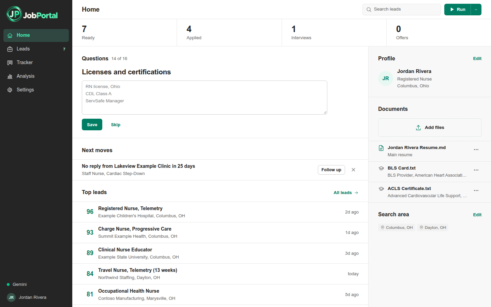
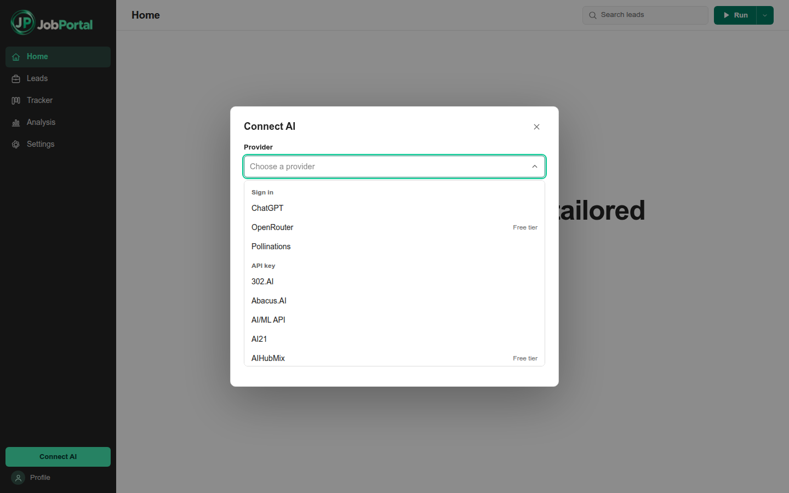
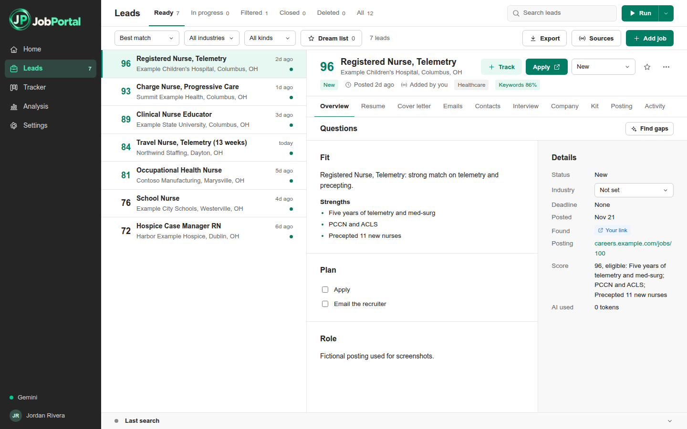
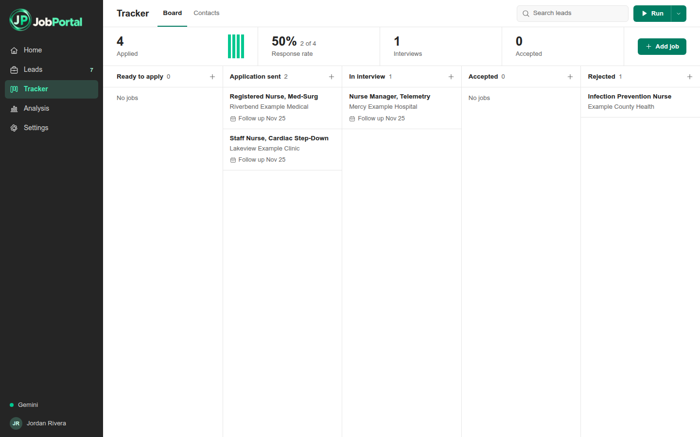
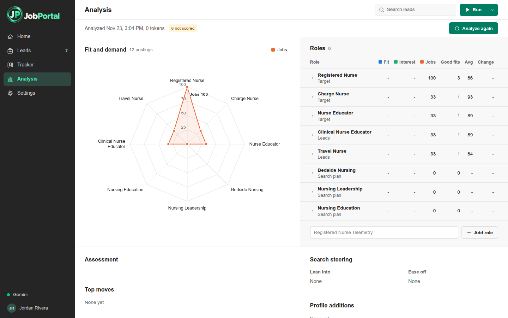

# JobPortal

JobPortal finds jobs that fit you and gets every application ready to send. It works for any kind of work and any
schooling, from farm work with no diploma to nursing, teaching, the trades and tech. It runs on your own computer, with
any AI you choose.

It's our capstone project for **CMSC 495 7304**.

## Why we built it

Looking for a job takes forever. You check ten different sites, read the same posting twice, and rewrite your resume for
every application. We wanted one app that handles the boring parts, so you can spend your time on the applications that
are actually worth it.

## How it works

You give JobPortal three things:

1. **Your resume, plus anything else that shows what you can do.** Drop in your resume with your certificates, licenses,
   cover letters, awards and transcripts, all at once. PDF, Word, ODT, RTF, Markdown or plain text. JobPortal picks your
   best resume as the main one and reads the details off each document, like a certificate's name, issuer and dates. No
   resume yet? Answer a few questions and fill in a few boxes, and JobPortal writes your first one.
2. **Answers to a few questions.** Home asks them one at a time: contact info, work authorization, schooling, the jobs
   and levels you want, and where you want to work. Most of these fill in from your resume.
3. **Answers to questions it asks along the way.** When a job wants something your profile doesn't show, JobPortal asks
   you about it. Your answer makes every application after that better.

That's all it learns from. JobPortal doesn't read anything else about you.

Then it searches in the places you pick (states, cities, remote, nationwide or another country):

- **Company job boards** on 36 hiring systems, from Greenhouse and Workday to the ones small businesses use
- **85 job sites and public job services**, including boards for one line of work (healthcare, schools, the trades,
  kitchens, farms, the arts and more), national job services and community sites
- **LinkedIn, remote job boards, Mastodon, Hacker News and RSS feeds**, plus USAJobs, Reddit, Bluesky, X, Adzuna and
  Google Jobs with your own key or account
- **AI hunt missions** that dig through places job boards miss, like bulletin boards, local news, union halls and small
  businesses
- **Posts you paste** from Discord, Slack, Facebook groups and other communities apps can't read

It can search on a schedule too, even in the background. Rule filters drop what doesn't fit your levels and places, the
AI scores the rest against your profile, and the best ones get a full package:

- a resume tailored to that job
- a cover letter
- outreach emails and the people to send them to
- interview prep and a company brief

Nothing is ever sent, posted or applied for without you.

## Download

Get the newest version from the [Releases page](https://github.com/mattsaund/JobPortal/releases). There's nothing else to
install.

| System | File | How to install |
|---|---|---|
| Windows 10 or 11 | `JobPortal-Windows-Setup.exe` | Double-click it. It installs JobPortal, adds Start menu and desktop shortcuts, and opens it. If SmartScreen warns, click More info, then Run anyway. |
| macOS (Apple Silicon) | `JobPortal-macOS.dmg` | Open it and drag JobPortal into Applications. If macOS blocks it, open System Settings, Privacy & Security, and click Open Anyway. |
| macOS (Intel) | `JobPortal-macOS-Intel.dmg` | The same, for Macs with an Intel processor. |
| Linux (x86_64) | `JobPortal-Linux-x86_64.AppImage` | Make it executable (`chmod +x`), then run it. The first run adds it to your app menu. |

The apps aren't code-signed yet. That's why Windows and macOS warn you the first time you open them.

## Connect an AI

JobPortal has no default AI. You pick one in the Connect AI popup, from 122 providers:

| How it connects | Providers |
|---|---|
| Sign in through your browser (3) | ChatGPT (a Go, Plus or Pro plan), OpenRouter and Pollinations |
| API key (104) | Claude, Gemini, OpenAI, Grok, Mistral, DeepSeek, Groq, the big clouds, model hosts and gateways |
| A server on your own computer (14) | Ollama, LM Studio, llama.cpp, Jan, GPT4All and others. No account needed |
| Any other address (1) | anything with an OpenAI-compatible API |

The popup marks the ones with a free tier. Your own account pays for what the AI uses, and a server on your own computer
costs nothing. The [user manual](documentation/USER_MANUAL.md) walks through everything.

## Using it

1. **Connect AI** from the welcome screen.
2. **Add your resume** and documents on Home, then answer the questions as they come. No resume? Click No resume and
   JobPortal writes one from your answers.
3. **Run a search** with Run at the top. Leads show up ranked as they qualify. To let it search by itself, turn on
   Scheduled runs in Settings, Search, Runs.
4. **Open a lead** on Leads to see why it fits, the tailored resume and cover letter, emails, contacts and interview
   prep. Download PDF or Word files from there, or use Export to get all the leads on a tab.
5. **Apply and track it.** Use the lead's Apply button, then follow it on the Tracker.

| Menu | What it's for |
|---|---|
| Home | your numbers, the questions JobPortal has for you, next moves, top leads, your profile, your documents and your search area |
| Leads | every job found, ranked, as a list with the details beside it. Tabs for each stage. Export, Sources (where JobPortal searches) and Add job are here |
| Tracker | your applications in five lanes: Ready to apply, Application sent, In interview, Accepted and Rejected. Drag jobs between lanes, add or delete them, and see your contacts |
| Analysis | a report on your fit and the market: a chart of your roles, the AI's assessment, skill gaps, and where good fits come from |
| Settings | Profile, Search (filters, plan, Dream list, industries, runs and the schedule), Resumes, AI, Appearance, History and Data |

## Screenshots

All made with a fictional user.

## Project status

- [x] Resume import and the standard job questions
- [x] Job search across boards, feeds and AI agents, in the locations you choose
- [x] Tailored resumes, cover letters and full application packages
- [x] One-click apps for Windows, macOS (Apple Silicon and Intel) and Linux
- [x] Works for any job, field and schooling, with a test of the filters across 56 kinds of work
- [x] Certificates, licenses, cover letters and awards read into the profile next to the resume
- [x] The team's green design in full-screen menus, with light and dark themes
- [x] Any AI: 122 providers by sign-in, API key or a server on your own computer
- [x] 85 job sites and public job services, and company boards on 36 hiring systems
- [x] Searches on a schedule, also in the background and after a restart
- [x] A first resume written from a few questions, for people who don't have one
- [x] Export of leads as a spreadsheet with a folder of documents for each
- [x] Screenshots
- [x] CI/CD, test coverage and benchmark evidence: [documentation/QUALITY_EVIDENCE.md](documentation/QUALITY_EVIDENCE.md)
- [ ] User testing with classmates
- [ ] Demo video
- [ ] Final presentation

## To do

- [ ] Change the name (maybe?) - Currently Pending
- [ ] Code signing so Windows and macOS stop warning. The Release workflow is ready and signs by itself once paid
      certificates are added as secrets. CONTRIBUTING.md, Releases, has what it takes.
- [ ] Try the whole flow on a few classmates' real resumes: ranked jobs in their areas, tailored resumes and cover
      letters, recruiter contacts and email templates for each match. The steps are in
      [documentation/USER_TESTING.md](documentation/USER_TESTING.md).
- [ ] Check desktop notifications on a real Windows PC and a real Mac. v0.3.0 changed how they're sent (a security fix),
      and it was only tested with stand-ins. Settings, Appearance, Test makes it a one-click check.

### Course deliverables (from the assignment PDFs)

- [ ] Unit 5, the parts only teammates can do: each person's own commits and pull request reviews, a peer review of one
      teammate's module, and a 250-word refinement report on technical debt.
- [ ] Unit 8: the 10 to 15 minute video, each person's 1,300-word paper, and team names and contributions.

## Built with

- **Python** and **FastAPI** for the local server
- **Plain JavaScript, HTML and CSS** for the dashboard (no build step)
- **SQLite** for storage
- **The AI you connect:** three request formats (OpenAI's Responses API, the chat completions API most services share, and
  Claude's Messages API) cover all 122 providers
- **pywebview** for the app window and **PyInstaller** for the release apps

## How it fits together

Our UML architecture diagram from Unit 3. The dashboard talks to a local server on your own computer, and the server's
packages do the work. The only traffic that leaves your computer is the AI you connected and the visits to job sites. With
an AI server on your own computer, the AI stays there too. The diagram was drawn for v0.3.0, so it still shows OpenAI as
the only AI, `style.css`, and fewer job sources.

There's a [PDF](documentation/school/2026-10-31%20UML%20architecture%20diagram.pdf) and an
[SVG](documentation/school/2026-10-31%20UML%20architecture%20diagram.svg) of it too.

## Your data

Everything stays on your computer, in one folder:

| System | Folder |
|---|---|
| Windows | `%LOCALAPPDATA%\JobPortal` |
| macOS | `~/Library/Application Support/JobPortal` |
| Linux | `~/.local/share/JobPortal` |

Settings, Data shows the exact path. To start over, quit JobPortal and delete that folder.

- The app's server only talks to your own computer. Other websites can't change anything in it.
- Each AI task sends your AI only what it needs. Your answers about gender, race, veteran status and disability are never
  sent. They only fill in the copy-and-paste kit for application forms.
- Tailored resumes can reorder and reword things, but they never make up experience, dates, numbers or skills.

## Working on JobPortal

Start with [CONTRIBUTING.md](CONTRIBUTING.md). It has the team list, what to install, a map of the code and how to run the
tests, plus how the code works. Our course documents and design ideas are in [documentation/](documentation/).

## License

MIT. See [LICENSE](LICENSE).
