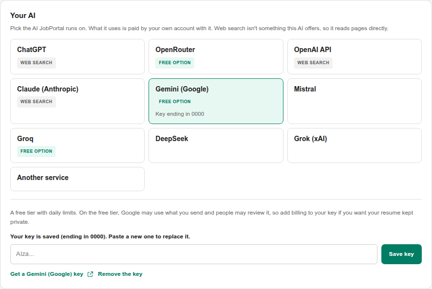
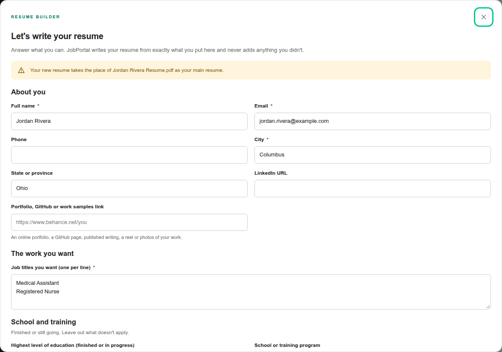

# JobPortal

JobPortal is our capstone project for **CMSC 495 7304**. It's a desktop app that finds jobs for you and gets every
application ready to send.

> This README is a work in progress. We'll keep updating it as the project moves along.

## Why we built it

Looking for a job as a student takes forever. You check ten different sites, read the same posting twice, and rewrite your
resume for every application. We wanted one app that handles the boring parts, so you can spend your time on the
applications that are actually worth it.

## How it works

You give JobPortal three things:

1. **Your resume, plus anything else that shows what you can do.** Drop in your resume with your certificates, licenses,
   cover letters, awards and transcripts, all at once. PDF, Word, ODT, RTF, Markdown or plain text. JobPortal picks your
   best resume as the main one and reads the details off each document, like a certificate's name, issuer and dates. No
   resume yet? Answer a few questions and fill in a few boxes, and JobPortal writes your first one.
2. **Answers to a few questions.** Home asks them one at a time: contact info, work authorization, education, the jobs
   and levels you want, and where you want to work. Most of these fill in from your resume.
3. **Answers to questions it asks along the way.** When a job wants something your profile doesn't show, JobPortal asks
   you about it. Your answer makes every application after that better.

That's all it learns from. JobPortal doesn't read anything else about you.

It works for any kind of job and any level, from high school and the trades to graduate degrees, and from an arts degree
to computer science.

Then it searches LinkedIn, company career sites, remote job boards, job lists, Hacker News, Reddit, Mastodon, Bluesky, X,
RSS feeds and USAJobs in the locations you pick: specific states and cities, remote, or nationwide. AI agents also dig
through places normal job boards miss, and you can paste posts from Discord, Slack, Facebook groups and other communities.
It can search on a schedule too, even in the background. Every job gets scored against your profile, and the best ones
get a full package:

- a resume tailored to that job
- a cover letter
- outreach emails and the people to send them to
- interview prep and a company brief

Nothing is ever sent, posted or applied for without you.

## Download

Get the newest version from the [Releases page](https://github.com/mattsaund/JobPortal/releases). There's nothing else to
install.

| System | File | How to install |
|---|---|---|
| Windows 10 or 11 | `JobPortal-Windows-Setup.exe` | Double-click it. It installs JobPortal, adds Start menu and desktop shortcuts, and opens it. If SmartScreen warns, click More info, then Run anyway. |
| macOS (Apple Silicon) | `JobPortal-macOS.dmg` | Open it and drag JobPortal into Applications. If macOS blocks it, open System Settings, Privacy & Security, and click Open Anyway. |
| macOS (Intel) | `JobPortal-macOS-Intel.dmg` | The same, for Macs with an Intel processor. |
| Linux (x86_64) | `JobPortal-Linux-x86_64.AppImage` | Make it executable (`chmod +x`), then run it. The first run adds it to your app menu. |

For the AI, you need one of these: a ChatGPT Go, Plus or Pro plan (one click to sign in), an OpenRouter account (sign in,
with free models), or an API key from Google Gemini (it has a free tier), Claude, OpenAI, Mistral, Groq, DeepSeek or xAI.
Your own account pays for what the AI uses. The [user manual](documentation/USER_MANUAL.md) walks through everything.

The apps aren't code-signed yet. That's why Windows and macOS warn you the first time you open them.

## Using it

1. **Home.** Connect your AI (Continue with ChatGPT, or pick another), drop your resume and documents, and answer the
   questions as they come in. No resume? Answer a few questions and JobPortal writes one.
2. **Run a search.** Use Run search at the top. Leads show up ranked as they qualify. To let it search by itself, turn on
   Search on a schedule in Settings, Search.
3. **Open a lead.** Click it on the Leads page to see everything: why it fits, the tailored resume and cover letter,
   emails, contacts and interview prep. Download PDF or Word files from there.
4. **Apply and track it.** Use the lead's Apply button, then follow it on the Tracker.

| Menu | What it's for |
|---|---|
| Home | your resume and documents, the questions JobPortal has for you, your next moves, and your top leads |
| Leads | every job found, ranked. Click one to open it. Sources (where JobPortal searches) is here too |
| Tracker | your applications on a board: Ready to apply, Application sent, In interview, Accepted and Rejected. Drag cards between columns, add or delete jobs, and see your contacts |
| Analysis | how your fit compares with what the market wants |
| Settings | your profile and answers, where and when to search, the Dream list, saved resumes, the AI you use, the light or dark theme and desktop alerts, search history and your data |

## Screenshots

All made with a fictional user.

## Project status

- [x] Resume import and the standard job questions
- [x] Job search across boards, feeds and AI agents, in the locations you choose
- [x] Tailored resumes, cover letters and full application packages
- [x] Sign in with ChatGPT
- [x] One-click apps for Windows, macOS and Linux
- [x] Works for any job, field and school level, with tech fully supported
- [x] Certificates, licenses, cover letters and awards read into the profile next to the resume
- [x] The team's new design: light and dark themes, a new logo, and five simple menus
- [x] Pick your AI: ChatGPT, OpenRouter, or an API key from Gemini, Claude, OpenAI and others
- [x] Searches on a schedule, also in the background and after a restart
- [x] A first resume written from a few questions, for people who don't have one
- [x] Apps for Intel Macs too
- [ ] User testing with classmates
- [x] Screenshots
- [ ] Demo video
- [ ] Final presentation

## To do

- [x] Add profile editing and creation. Settings, Profile edits every part of the profile, and anyone without a resume
      gets one written from a few questions and text boxes on Home (the resume builder). With a resume, nothing it covers
      is asked again.
- [x] Job listing saving
- [x] Get a good color scheme
- [x] Pick a good font
- [x] Get a good logo
- [ ] Change the name (maybe?) - Currently Pending
- [x] Simplify the UI: fewer buttons and fewer words. Sleek, simple and easy to use.
- [x] Test Sign in with ChatGPT and a full search with a real ChatGPT plan, end to end.
- [x] Finish extra documents in the dashboard: drop your resume with other resumes, certificates, licenses, cover letters
      and awards at once on Home. The best resume becomes the main one (with a button to pick a different one), and each
      document's details (title, issuer, dates, skills) are read into the profile.
- [x] A continuous stream of leads: searches on a schedule at the times and days you pick (Settings, Search). Off until
      you turn it on. With background searching on, it keeps going after the window closes and after a restart.
- [x] Reach everywhere, in the ways each place allows: X through its official API (with your own developer key), Discord,
      Slack, Facebook groups, Threads and LinkedIn posts through Paste posts, Indeed, ZipRecruiter and Handshake through
      the AI hunt's web searches, and new boards (Himalayas, Jobicy, Working Nomads, Recruitee, Personio). Telegram is left
      out because its terms bar using its content with AI.
- [x] Make it ready for people outside the team: clearer first-run help on the welcome screen, other AIs for people
      without a ChatGPT plan (Sign in with OpenRouter, or an API key), and an Intel Mac build
- [ ] Code signing so Windows and macOS stop warning (maybe). It needs paid certificates; CONTRIBUTING.md, Releases, has
      what it takes.
- [x] Make it work for anyone, any degree or school level (high school, trades, college, graduate). Tech stays fully
      supported. The filters, keywords, sources, prompts and the Analysis page adapt to each person's own fields.
- [x] Make job search type as broad as possible covering all types of jobs.
- [ ] Try the whole flow on a few classmates' resumes: ranked jobs in their areas, tailored resumes and cover letters,
      recruiter contacts and email templates for each match. The steps are in
      [documentation/USER_TESTING.md](documentation/USER_TESTING.md).
- [ ] Check desktop notifications on a real Windows PC and a real Mac. v0.3.0 changed how they're sent (a security fix),
      and it was only tested with stand-ins. Settings, Appearance, Send a test alert makes it a one-click check.
- [x] A small "Next moves" card on Home with the best rules from the old Equity mining page: applications with no reply
      after 21 days, companies with several openings, and new openings at companies that turned you down before

### Course deliverables (from the assignment PDFs)

- [ ] Unit 3: system design spec. The UML architecture diagram is done: `documentation/school/2026-10-31 UML architecture
      diagram` (PDF, PNG and SVG). Still to do: interface contracts (API endpoints, request and response formats, errors;
      FastAPI serves them at http://127.0.0.1:8788/docs) and a 500-word design rationale. The ARCHITECTURE.md we removed is
      in the git history and makes a good start.
- [ ] Unit 5: everyone commits and reviews pull requests, each of us peer reviews one teammate's module, and each writes a
      250-word refinement report on technical debt. The alpha is v0.3.0. CI now reports test coverage and performance
      benchmarks, and the pull request template has a reviewer checklist.
- [ ] Unit 8: API docs, an installation guide and a user manual, CI/CD screenshots, a test coverage report, performance
      benchmarks, a 10 to 15 minute video, and a 1,300-word paper each, with team names and contributions. First drafts of
      the [API reference](documentation/API.md), [installation guide](documentation/INSTALL.md) and
      [user manual](documentation/USER_MANUAL.md) are in documentation/. CI's summary page has the coverage table and the
      benchmark timings.

## Built with

- **Python** and **FastAPI** for the local server
- **Plain JavaScript, HTML and CSS** for the dashboard (no build step)
- **SQLite** for storage
- **The AI the user picks:** OpenAI's Responses API through Sign in with ChatGPT or an OpenAI key, OpenRouter, Claude's
  Messages API, or the chat completions API of Gemini, Mistral, Groq, DeepSeek, xAI and others
- **pywebview** for the app window and **PyInstaller** for the release apps

## How it fits together

Our UML architecture diagram from Unit 3. The dashboard talks to a local server on your own computer, and the server's
packages do the work. The only traffic that leaves your computer is the sign-in and AI requests to OpenAI and the visits
to job sites.

There's a [PDF](documentation/school/2026-10-31%20UML%20architecture%20diagram.pdf) and an
[SVG](documentation/school/2026-10-31%20UML%20architecture%20diagram.svg) of it too.

## Your data

Everything stays on your computer, in one folder:

| System | Folder |
|---|---|
| Windows | `%LOCALAPPDATA%\JobPortal` |
| macOS | `~/Library/Application Support/JobPortal` |
| Linux | `~/.local/share/JobPortal` |

Settings, Data shows the exact path. To start over, quit JobPortal and delete that folder.

- The app's server only talks to your own computer. Other websites can't change anything in it.
- Each AI task sends OpenAI only what it needs. Your answers about gender, race, veteran status and disability are never
  sent. They only fill in the copy-and-paste kit for application forms.
- Tailored resumes can reorder and reword things, but they never make up experience, dates, numbers or skills.

## Working on JobPortal

Start with [CONTRIBUTING.md](CONTRIBUTING.md). It has the team list, what to install, a map of the code and how to run the
tests, plus how the code works. Our school documents and design ideas are in [documentation/](documentation/).

## License

MIT. See [LICENSE](LICENSE).
