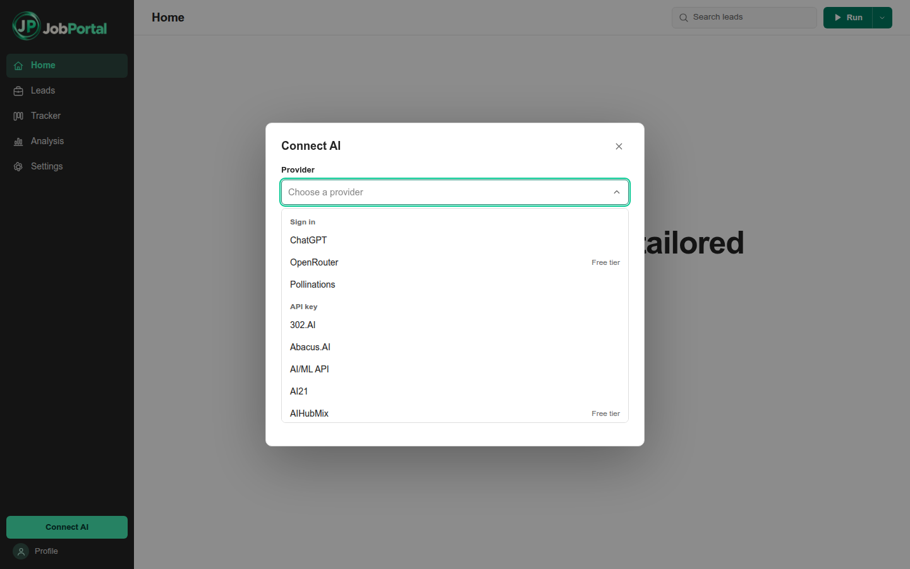

# Installing JobPortal

This guide covers installing JobPortal on Windows, macOS and Linux, the first run, connecting an AI, where your data lives,
updating, uninstalling, and running it from the source code. The [user manual](USER_MANUAL.md) covers using it.

## What you need

- A computer with Windows 10 or 11, macOS (Apple Silicon or Intel), or 64-bit Linux.
- An AI JobPortal can use. There's no default, and any one of these works:
  - a sign-in through your browser: ChatGPT (a Go, Plus or Pro plan), OpenRouter or Pollinations
  - an API key from one of 104 providers, like Google Gemini (it has a free tier), Claude, OpenAI, Grok, Mistral, DeepSeek
    or Groq
  - a model server on your own computer, like Ollama or LM Studio (no account needed)
  - any other service with an OpenAI-compatible API

An online AI bills your own account for what it uses, and you can set a spending limit there.

## Download and install

Get the newest version from the [Releases page](https://github.com/mattsaund/JobPortal/releases).

| System | File | How to install |
|---|---|---|
| Windows 10 or 11 | `JobPortal-Windows-Setup.exe` | Double-click it. It installs JobPortal for your user, adds Start menu and desktop shortcuts, and opens it. |
| macOS (Apple Silicon) | `JobPortal-macOS.dmg` | Open it and drag JobPortal into Applications. |
| macOS (Intel) | `JobPortal-macOS-Intel.dmg` | The same, for Macs with an Intel processor. |
| Linux (x86_64) | `JobPortal-Linux-x86_64.AppImage` | Make it executable (`chmod +x JobPortal-Linux-x86_64.AppImage`), then run it. The first run adds it to your app menu. |

Everything JobPortal needs comes inside the download, including what it uses to print resumes to PDF.

### The first open warns you

The apps aren't code-signed yet, so each system asks before it opens an app from an unknown developer.

- **Windows:** if SmartScreen says it protected your PC, click More info, then Run anyway.
- **macOS:** if macOS says it can't check the app, open System Settings, Privacy & Security, scroll down and click Open
  Anyway, then open JobPortal again.
- **Linux:** nothing to approve. Without Chrome, Edge, Chromium or Brave installed, JobPortal opens in a browser tab
  instead of a window of its own.

## The first time you open it

1. **Connect an AI.** Click Connect AI and pick one (see below).
2. **Add your resume** with any certificates, licenses, cover letters, awards or transcripts. No resume? Click No resume,
   answer a few questions, and JobPortal writes one.
3. **Answer the questions** Home asks, one at a time. JobPortal fills in what your resume already says.
4. **Run a search** with Run at the top, or turn on Scheduled runs in Settings, Search, Runs.

## Connecting an AI



Click **Connect AI** on the welcome screen or in the sidebar. Later, you can also use Change in Settings, AI. In the popup,
type to find your AI in the Provider box, or scroll the list. It's grouped by how each one connects:

- **Sign in:** JobPortal opens the provider's page in your browser. Approve it, and the popup closes by itself.
- **API key:** paste your key. **Get key** opens the page where you make one. Keys stay on your computer.
- **On this computer:** a model server you run yourself. See the next section.
- **Other:** any service with an OpenAI-compatible API. Enter its address, and a key if it needs one.

A few cloud services also ask for their resource name, region or account. JobPortal checks every connection by asking for
the provider's model list, and it only keeps a connection that works. If a service has no model list, the popup asks for
a model name and checks it with one small request.

### Using an AI on your own computer

JobPortal can use a model server running on your computer, so what the AI reads never leaves it. JobPortal doesn't install
these servers or download models. Install one, load a model, and start its local server.

| Server | Address JobPortal fills in |
|---|---|
| Ollama | `http://localhost:11434/v1` |
| LM Studio | `http://localhost:1234/v1` |
| llama.cpp | `http://127.0.0.1:9931/v1` |
| vLLM | `http://localhost:8000/v1` |
| LocalAI | `http://localhost:8080/v1` |
| Jan | `http://127.0.0.1:1337/v1` |
| KoboldCpp | `http://localhost:5001/v1` |
| text-generation-webui | `http://127.0.0.1:5000/v1` |
| GPT4All | `http://localhost:4891/v1` |
| MLX | `http://127.0.0.1:8080/v1` |
| Docker Model Runner | `http://localhost:12434/engines/v1` |
| Lemonade | `http://localhost:13305/v1` |
| SGLang | `http://127.0.0.1:30000/v1` |
| LiteLLM proxy | `http://localhost:4000/v1` |

Pick your server under **On this computer**, change the address if yours runs on another port, and click Connect.

- A key is optional, for a server you've set one up on.
- With Ollama, set `OLLAMA_CONTEXT_LENGTH` to 16000 or more, because JobPortal's prompts are long.
- A model that can call tools works best. One that can't still works, because JobPortal then asks it for plain JSON and
  checks the answer the same way.
- JobPortal's heavier tasks need a capable model, and a small one can be slow or give weak results.

## Where your data lives

Everything JobPortal keeps (your profile, leads, documents, tailored files, sign-ins and keys) stays in one folder on your
computer. Settings, Data, Open shows it.

| System | Folder |
|---|---|
| Windows | `%LOCALAPPDATA%\JobPortal` |
| macOS | `~/Library/Application Support/JobPortal` |
| Linux | `~/.local/share/JobPortal` |

## Searching in the background

When you turn on Scheduled runs with "Run in background" (Settings, Search, Runs), JobPortal keeps a small server running
after its window closes, and adds itself to the programs your system starts when you log in:

| System | Where the login item is |
|---|---|
| Windows | the `JobPortal` value in `HKEY_CURRENT_USER\Software\Microsoft\Windows\CurrentVersion\Run` |
| macOS | `~/Library/LaunchAgents/io.github.mattsaund.jobportal.plist` |
| Linux | `~/.config/autostart/jobportal-background.desktop` |

Turning background searching off removes the login item, and the background server quits a few minutes later. Settings,
Data has a Quit button while it runs.

## Updating

Download the new version and install it the same way, over the old one. Your data stays, because it lives in the data
folder, not in the app.

## Uninstalling

1. Turn off Run in background in Settings, Search, Runs, so the login item is removed.
2. Remove the app:
   - **Windows:** Settings, Apps, Installed apps, JobPortal, Uninstall.
   - **macOS:** drag JobPortal from Applications to the Trash.
   - **Linux:** delete the AppImage, and `~/.local/share/applications/jobportal.desktop` for the app menu entry.
3. To delete your data too, delete the data folder above. That also forgets your sign-ins and keys on this computer.

## Running from the source code

You need Python 3.11 or newer and Git.

```bash
git clone https://github.com/mattsaund/JobPortal.git
cd JobPortal
./run.sh          # macOS and Linux
.\run.ps1         # Windows PowerShell (or run.bat)
```

The first run creates a Python environment in `.venv` and installs JobPortal into it. Later runs start right away. To work
on the code, install the developer tools with `pip install -e ".[dev]"` and see [CONTRIBUTING.md](../CONTRIBUTING.md).

## Troubleshooting

- **Check everything at once:** run JobPortal with `--doctor` (`./run.sh --doctor`, or the installed app's program with
  `--doctor`). It checks Python, the data folder, the AI's sign-in or key, the login item, the PDF engine, the window
  toolkit and the port.
- **Another program uses port 8788:** start JobPortal with `--port 8790`.
- **The AI says to connect it:** click Connect AI, check which AI is picked, and sign in or save its key again.
- **"Couldn't connect" with a local server:** check that the server is running, that a model is loaded, and that the
  address and port match. Open the address plus `/models` in a browser to see if it answers.
- **"Out of credit" or "limiting how many requests":** your AI account reached a limit. Add credit or wait, and searching
  goes on by itself.
- **PDF downloads don't work from source:** install Chrome, Edge, Chromium or Brave. The downloaded apps already have
  what they need.
