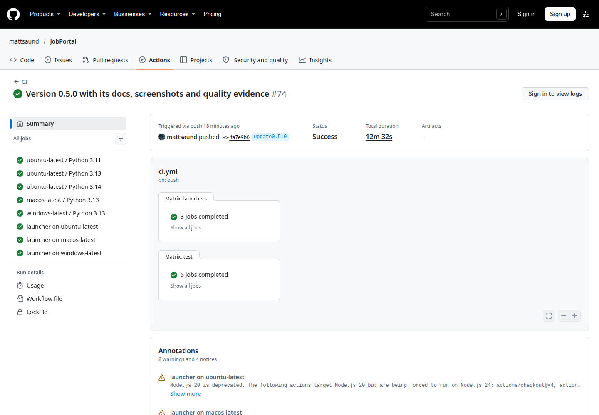
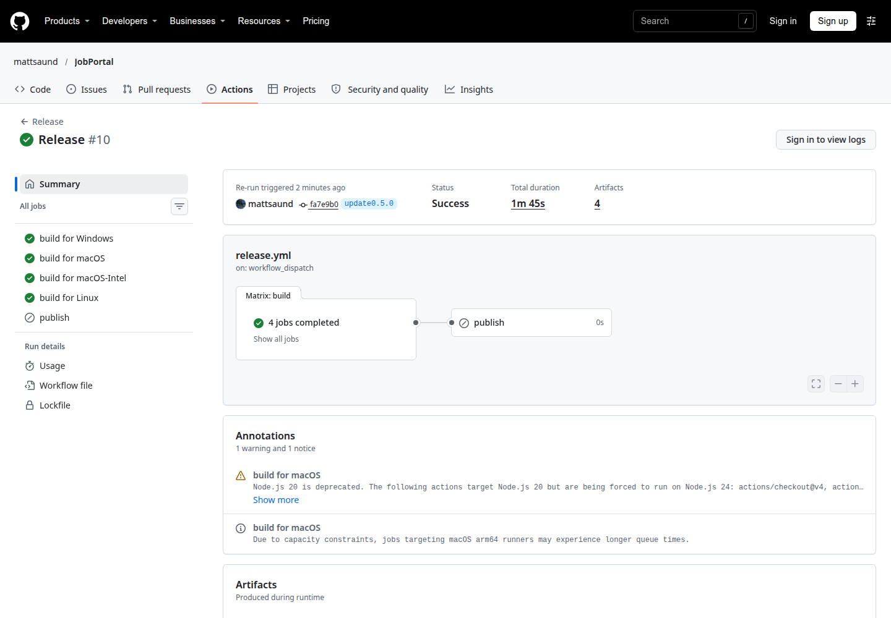

# Quality evidence

The evidence for the Unit 8 rubric: CI/CD, tests and coverage, performance benchmarks, code review, and a live trial of the
search. Every number here comes from a real run. The tests and benchmarks ran on 2026-11-23 on the 0.5.0 code.

## 1. CI/CD

GitHub Actions runs three workflows, in [`.github/workflows/`](../.github/workflows/). Every run is public on the
[Actions page](https://github.com/mattsaund/JobPortal/actions).

| Workflow | When it runs | What it does | Systems |
|---|---|---|---|
| **CI** (`ci.yml`) | every push and pull request, unless it only changes Markdown or `documentation/` | runs the linter (ruff), every test with coverage and the benchmarks, `jobportal --doctor` and a server smoke test. On Linux it also checks every dashboard script with `node --check`. Launcher jobs run `run.sh` or `run.ps1` from a clean checkout | Ubuntu with Python 3.11, 3.13 and 3.14. macOS and Windows with Python 3.13. Launchers on all three with Python 3.12 |
| **Writing rules** (`writing.yml`) | every push and pull request | runs `tests/test_writing.py` (no em dashes, no middle dots, American spelling), so changes that only touch docs get checked too | Ubuntu with Python 3.13 |
| **Release** (`release.yml`) | a pushed version tag, or by hand as a dry run | builds the app for each system with PyInstaller, then starts each one, checks that it answers and prints a real PDF. It also runs the Windows installer and starts the installed app. For a tag, it publishes the files on the [Releases page](https://github.com/mattsaund/JobPortal/releases) | Windows, macOS (Apple Silicon), macOS (Intel) and Ubuntu 22.04 |

CI fails when the lint, a test, a benchmark limit or the 75% coverage floor fails. Each run's summary page shows the coverage
table and the benchmark timings.

Code signing is wired into the Release workflow and turns on once certificates are added as repository secrets. It hasn't
run with a real certificate yet, so the release apps are still unsigned.

### Real runs

These are the runs on the 0.5.0 code from 2026-11-23, plus the last published release before it.

| Workflow | Run | What it ran on | Result |
|---|---|---|---|
| CI | [45267871154](https://github.com/mattsaund/JobPortal/actions/runs/45267871154) | `update0.5.0`, 8 jobs (5 test, 3 launcher) | success |
| Writing rules | [45267871271](https://github.com/mattsaund/JobPortal/actions/runs/45267871271) | `update0.5.0`, 1 job | success |
| Release (dry run) | [45267886124](https://github.com/mattsaund/JobPortal/actions/runs/45267886124) | 4 builds, each started and smoke tested, nothing published. The Apple Silicon job got no GitHub runner on the first attempt and passed when run again | success |
| Release | [44372383040](https://github.com/mattsaund/JobPortal/actions/runs/44372383040) | tag `v0.4.0`, 4 builds and the publish | success |

A green CI run, with every test and launcher job passing on all three systems:

A green Release dry run, with the four app builds. The publish step only runs for a version tag:

## 2. Tests and coverage

From `python -m pytest --cov --cov-report=term` on Linux with Python 3.14.10:

- **530 tests, all passing.**
- **85% coverage** of the `jobportal` package (8,969 statements, 1,324 missed, 85.24% before rounding). CI fails
  below the 75% floor in `pyproject.toml`.

The tests never reach a real AI service or a real job site. AI answers come from a fake or a mock service, and collectors
read canned replies. Every test starts from an empty data folder and uses fictional people.

Coverage measures the Python code. The dashboard's JavaScript has no unit tests, and CI checks its syntax with
`node --check`.

| Package | Statements | Missed | Coverage |
|---|---|---|---|
| `core` | 957 | 88 | 91% |
| `ai` | 1,158 | 105 | 91% |
| `candidate` | 1,083 | 82 | 92% |
| `documents` | 884 | 81 | 91% |
| `search` | 3,052 | 516 | 83% |
| `insights` | 535 | 28 | 95% |
| `web` | 888 | 191 | 78% |
| `app` | 408 | 230 | 44% |
| **Total** | **8,969** | **1,324** | **85%** |

The lowest files are the ones tied to a real window, a real network or a real AI: `app/doctor.py` (0%, CI runs it as a
command instead), `search/collectors/hunt.py` (38%), `app/desktop.py` (49%), `core/osutil.py` (57%, each system
runs only its own branches) and `search/collectors/feeds.py` (58%).

Coverage of every file

| File | Statements | Missed | Coverage |
|---|---|---|---|
| `__init__.py` | 1 | 0 | 100% |
| `__main__.py` | 3 | 3 | 0% |
| `ai/client.py` | 678 | 68 | 90% |
| `ai/prompts.py` | 43 | 0 | 100% |
| `ai/provider_list.py` | 5 | 0 | 100% |
| `ai/providers.py` | 230 | 13 | 94% |
| `ai/signin.py` | 202 | 24 | 88% |
| `app/cli.py` | 112 | 45 | 60% |
| `app/desktop.py` | 227 | 116 | 49% |
| `app/doctor.py` | 69 | 69 | 0% |
| `candidate/builder.py` | 70 | 2 | 97% |
| `candidate/documents.py` | 357 | 23 | 94% |
| `candidate/library.py` | 54 | 7 | 87% |
| `candidate/onboarding.py` | 244 | 4 | 98% |
| `candidate/profile.py` | 358 | 46 | 87% |
| `core/background.py` | 19 | 0 | 100% |
| `core/bus.py` | 37 | 2 | 95% |
| `core/config.py` | 26 | 0 | 100% |
| `core/db.py` | 104 | 1 | 99% |
| `core/genres.py` | 47 | 1 | 98% |
| `core/levels.py` | 67 | 0 | 100% |
| `core/osutil.py` | 166 | 71 | 57% |
| `core/settings.py` | 137 | 4 | 97% |
| `core/textutil.py` | 354 | 9 | 97% |
| `documents/exports.py` | 159 | 12 | 92% |
| `documents/extract.py` | 211 | 25 | 88% |
| `documents/render.py` | 386 | 24 | 94% |
| `documents/resumecheck.py` | 104 | 14 | 87% |
| `documents/revise.py` | 24 | 6 | 75% |
| `insights/analysis.py` | 474 | 28 | 94% |
| `insights/moves.py` | 61 | 0 | 100% |
| `search/collectors/__init__.py` | 2 | 0 | 100% |
| `search/collectors/ats.py` | 446 | 62 | 86% |
| `search/collectors/base.py` | 101 | 6 | 94% |
| `search/collectors/catalog.py` | 445 | 36 | 92% |
| `search/collectors/details.py` | 84 | 28 | 67% |
| `search/collectors/feeds.py` | 446 | 187 | 58% |
| `search/collectors/github_lists.py` | 30 | 5 | 83% |
| `search/collectors/hunt.py` | 60 | 37 | 38% |
| `search/collectors/linkedin.py` | 95 | 12 | 87% |
| `search/collectors/readers.py` | 180 | 19 | 89% |
| `search/countries.py` | 69 | 1 | 99% |
| `search/packages.py` | 250 | 25 | 90% |
| `search/pipeline.py` | 533 | 68 | 87% |
| `search/plan.py` | 65 | 0 | 100% |
| `search/posts.py` | 37 | 0 | 100% |
| `search/schedule.py` | 157 | 9 | 94% |
| `search/sources.py` | 52 | 21 | 60% |
| `web/common.py` | 20 | 4 | 80% |
| `web/routes/__init__.py` | 2 | 0 | 100% |
| `web/routes/ai.py` | 103 | 7 | 93% |
| `web/routes/candidate.py` | 165 | 35 | 79% |
| `web/routes/documents.py` | 60 | 20 | 67% |
| `web/routes/insights.py` | 69 | 3 | 96% |
| `web/routes/leads.py` | 206 | 66 | 68% |
| `web/routes/library.py` | 82 | 31 | 62% |
| `web/routes/search.py` | 45 | 8 | 82% |
| `web/routes/settings.py` | 34 | 3 | 91% |
| `web/routes/system.py` | 51 | 13 | 75% |
| `web/server.py` | 51 | 1 | 98% |

Tests in each file

| File | Tests |
|---|---|
| `test_agnostic.py` | 66 |
| `test_ai.py` | 30 |
| `test_analysis.py` | 13 |
| `test_api.py` | 34 |
| `test_builder.py` | 5 |
| `test_catalog.py` | 139 |
| `test_core.py` | 30 |
| `test_extract.py` | 11 |
| `test_levels.py` | 10 |
| `test_moves.py` | 5 |
| `test_onboarding.py` | 16 |
| `test_performance.py` | 6 |
| `test_platform.py` | 13 |
| `test_profile.py` | 18 |
| `test_providers.py` | 31 |
| `test_reach.py` | 7 |
| `test_render.py` | 14 |
| `test_schedule.py` | 18 |
| `test_search.py` | 62 |
| `test_writing.py` | 2 |

## 3. Performance benchmarks

`tests/test_performance.py` times six heavy, everyday jobs on fictional data, at the size a heavy user reaches. A benchmark
fails the build when it takes longer than its limit, so CI catches a real slowdown. These timings are from one run with
`JOBPORTAL_BENCHMARK_REPORT` set, on Linux with Python 3.14.10:

| Benchmark | Time | Limit |
|---|---|---|
| rule filters, 5,000 postings | 61 ms | 5 s |
| location matching, 20,000 places | 61 ms | 2 s |
| keyword extraction, 300 postings | 755 ms | 3 s |
| Leads page, 2,000 saved leads | 17 ms | 2 s |
| Tracker board, 2,000 saved leads | 42 ms | 2 s |
| Analysis numbers, 2,000 leads and 3,000 waiting postings | 27 ms | 5 s |

## 4. Code review

Our process is that work happens on a branch and reaches `main` through a
[pull request](https://github.com/mattsaund/JobPortal/pulls). [CONTRIBUTING.md](../CONTRIBUTING.md) has the rules: CI must be
green, and one teammate reviews with GitHub's Review changes button before merging.

Pull requests open with [a template](../.github/pull_request_template.md) in three parts:

- **How I tested it:** ruff and pytest pass, the change was tried in the app, and it works on Windows, macOS and Linux.
- **Checklist, for the author:** no personal data, prompts still forbid inventing anything, the profile still learns only
  from the user's own material, plain writing, and anything an AI assistant wrote was read, run and tested.
- **Review checklist, for the reviewer:** code quality and readability, security, performance, integration, documentation
  and tests.

GitHub shows 15 merged pull requests from five people on the team. None of them has a formal GitHub review yet. Branch
protection isn't on either, so the review step is a team rule that GitHub doesn't enforce. Each teammate's reviews are on
the README's To do list under Unit 5.

## 5. Live trial

On 2026-11-23 we ran six fictional people in very different lines of work through the real public job sources and the real
rule filters. **The trial ran without an AI.** Nothing was scored or tailored by a model, and no real person's data was used.
It read the catalog of job sites and public job services, the remote boards and Mastodon.

| Looking for | Schooling | Jobs found | Kept by filters | Sources |
|---|---|---|---|---|
| Registered Nurse | Bachelor's | 186 | 56 | 14 |
| Welder, Pipefitter | Trade certificate | 109 | 25 | 7 |
| Elementary, Substitute Teacher | Bachelor's | 1,299 | 598 | 25 |
| Line Cook, Kitchen Manager | High school | 289 | 100 | not recorded |
| Warehouse, Forklift, Truck Driver | Some high school | 245 | 52 | 13 |
| Farm Worker, Vet Tech | No formal schooling | 1,404 | 134 | 19 |

Jobs found counts each job once. Kept by filters is how many passed the rule filters for that person's work, level and
place. Sources is how many different sources the kept jobs came from.

The trial shows that the search and the filters reach real postings for very different people, with or without a degree.
It doesn't show how well an AI scores them or how good the tailored documents are, and it wasn't a test with real users.
That trial is still on the [To do list](../README.md#to-do), and its steps are in [USER_TESTING.md](USER_TESTING.md).
