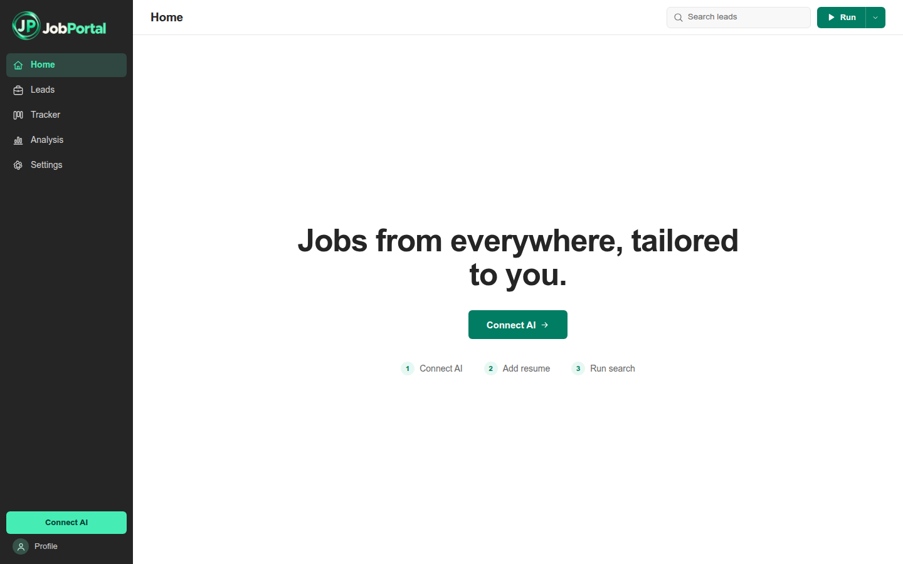
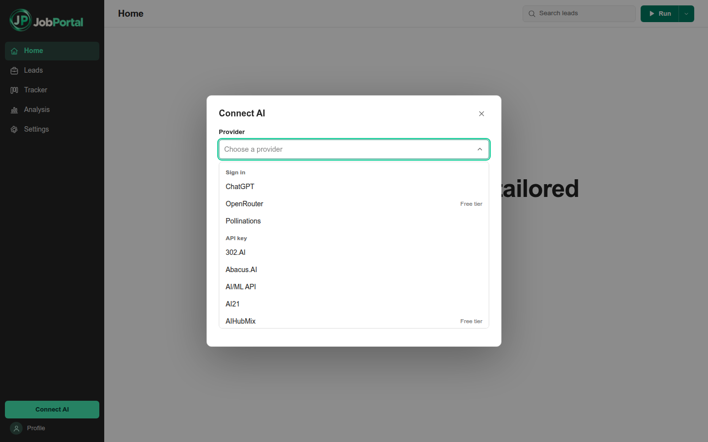
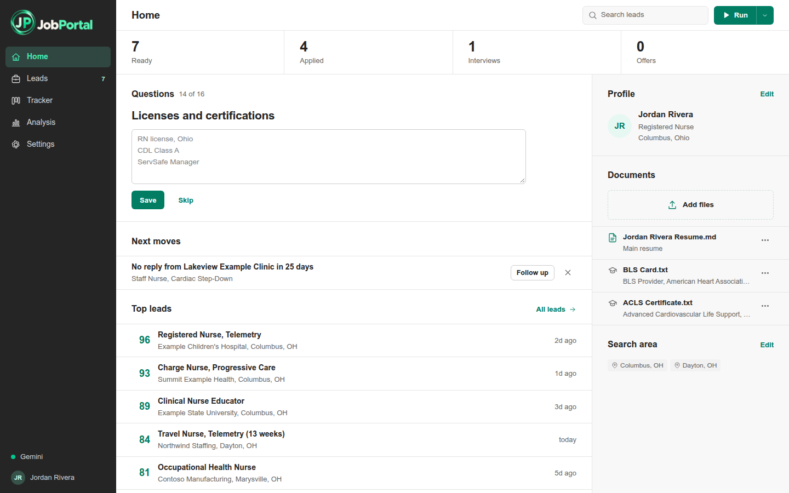
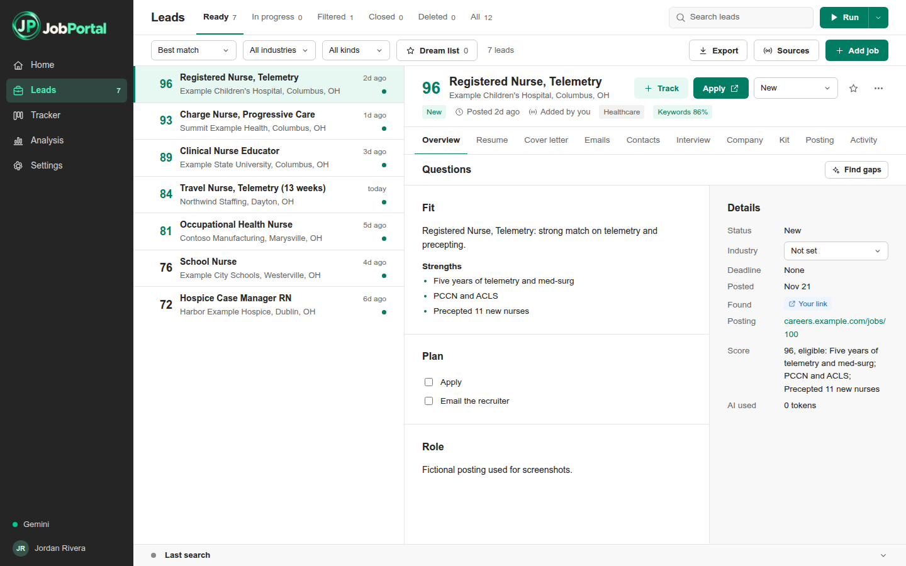
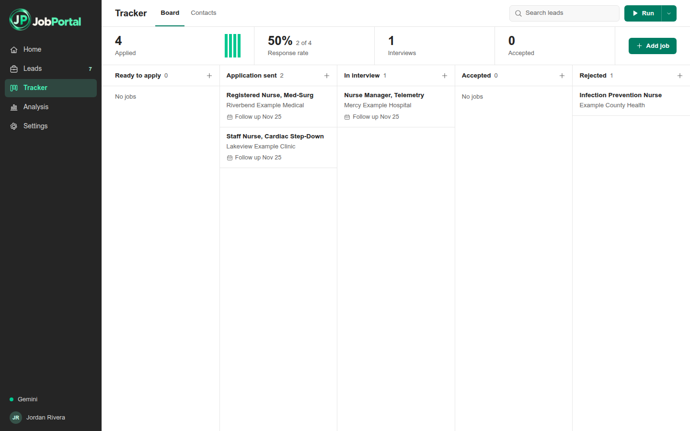

# JobPortal user manual

JobPortal finds jobs that fit you and gets each application ready to send: a tailored resume, a cover letter, outreach
emails with the people to send them to, and interview prep. It works for any kind of work and any schooling. Everything
stays on your computer, and nothing is ever sent, posted or applied for without you.

To install it, see the [installation guide](INSTALL.md). The pictures here use a fictional person.

## Contents

1. [Getting started](#1-getting-started)
2. [Connect AI](#2-connect-ai)
3. [Finding your way around](#3-finding-your-way-around)
4. [Home](#4-home)
5. [Leads](#5-leads)
6. [A lead's details](#6-a-leads-details)
7. [Tracker](#7-tracker)
8. [Analysis](#8-analysis)
9. [Settings](#9-settings)
10. [Privacy and costs](#10-privacy-and-costs)
11. [Questions](#11-questions)

## 1. Getting started

1. **Connect an AI.** Click Connect AI and pick one. See [Connect AI](#2-connect-ai).
2. **Add your resume.** Drop it on Home with anything else that shows what you've done: certificates, licenses, cover
   letters, awards, transcripts. PDF, Word, ODT, RTF, Markdown and plain text all work. JobPortal picks your best resume as
   the main one, and you can pick another. You can also paste your resume's text.
3. **No resume?** Click No resume under the drop zone. See [the resume builder](#the-resume-builder).
4. **Answer the questions.** Home asks the standard job questions one at a time, required ones first. Whatever your resume
   answers is filled in already, so you only check it and click Confirm.
5. **JobPortal builds your profile.** It reads everything you gave it and writes your profile: your experience, skills and
   what to search for. This takes a few minutes.
6. **Run a search.** Click Run at the top, or [search on a schedule](#runs-and-the-schedule).

### The resume builder

The builder asks for your contact details, the jobs you want, your schooling, your work and volunteering (paid or not),
your skills and languages, licenses, and projects and awards. You don't need a degree or a work history to use it. Click
Write resume, and the AI writes a one-page resume from exactly what you wrote. It never adds anything you didn't write.

The new resume becomes your main resume, and a copy goes to Settings, Resumes, where you can edit it and download it as a
PDF or Word file. To change something, open the main resume's menu under Documents and click Edit answers.

## 2. Connect AI

JobPortal has no default AI. It runs on the one you connect. Click **Connect AI** on the welcome screen or in the sidebar,
or **Change** in Settings, AI. Then type in the Provider box to find yours. The list has 122 providers in four groups:

| Group | How it connects |
|---|---|
| **Sign in** (ChatGPT, OpenRouter, Pollinations) | JobPortal opens the provider's page in your browser. Approve it there and come back. ChatGPT needs a Go, Plus or Pro plan. OpenRouter and Pollinations also take a pasted key. |
| **API key** (104 providers) | Paste your key. **Get key** opens the page where you make one. |
| **On this computer** (14 servers, like Ollama and LM Studio) | Start the server, check its address, and click Connect. No key needed. The [installation guide](INSTALL.md#using-an-ai-on-your-own-computer) lists them. |
| **Other** | Any service with an OpenAI-compatible API. Enter its address, and a key if it needs one. |

JobPortal checks every connection before it keeps it, so a wrong key or address shows up right away. If a service has no
model list, the popup asks for a model name. Providers with a free tier say so in the list.

To change AIs, open the popup and pick another. To stop using one, pick it and click Disconnect. A key you remove stays
valid at the provider, so delete it there if you're done with it.

Some AIs can search the web themselves (ChatGPT, the OpenAI API, Claude and Perplexity). The others read pages directly,
which works too, a little less widely.

## 3. Finding your way around

- **The sidebar** on the left has the five menus: Home, Leads, Tracker, Analysis and Settings. At the bottom are the AI in
  use (click it to change) and your name (click it for your profile).
- **The top bar** has the page's title and tabs, a search box for your leads (press `/` to jump to it), and **Run**.
- **Run** starts a full search. Its arrow offers the other kinds: Everything, Job boards (no AI hunt), AI hunt (only the
  AI's missions) and Queue (only tailor the leads already waiting). While a search runs, Run becomes Stop.

## 4. Home

- **The numbers** across the top: Ready, Applied, Interviews and Offers. Each opens the page it counts.
- **Questions:** one thing at a time. Your resume, what was read from it, the standard questions, the profile build, then
  questions JobPortal asks along the way. Each answer makes every later application better.
- **Next moves:** a few things worth doing soon, when there are any. An application with no reply after three weeks
  (follow up, or move it to Rejected), a new opening at a company that turned you down before, and companies with several
  openings that fit you. Hide one to keep it away for 30 days.
- **Top leads:** your eight best matches that are ready to apply.
- **On the right:** your profile, your documents and your search area. Documents is where you add files. Each file's menu
  can make it the main resume, read it again or remove it, and the main resume's menu can show its text or replace it.

## 5. Leads

Every job JobPortal found, ranked by how well it fits you. The list is on the left and the selected lead fills the right.
In a narrow window, the list shows alone and a lead opens full screen.

The tabs in the top bar split them by stage: **Ready** (tailored and ready to apply), **In progress**, **Filtered**,
**Closed**, **Deleted** and **All**. Above the list you can sort (best match, newest, deadline, recently posted, industry),
filter by industry or kind (jobs, programs, events, companies), and show only your **Dream list**. The search box in the
top bar searches your leads from any page.

- **Export** downloads a zip of the leads on the open tab, with the filters you've set (up to 100 leads). It holds a
  spreadsheet of the leads and a folder for each one with its tailored resume, cover letter, emails, contacts and the rest.
- **Sources** is the menu of where JobPortal looks. Down its left side are your search terms, job boards (company boards,
  LinkedIn, USAJobs, remote boards, Adzuna, Google Jobs), communities (Reddit, Hacker News, Mastodon, Bluesky, X), feeds and
  lists, the catalog's field boards, general boards, public job services, community sites and discovery, and the AI hunt.
  Each source has a switch and a **Test** button that shows what it finds right now. Sources marked **For you** run for your
  kind of work and your country. To add a company, paste its careers page under Company boards, and JobPortal finds the
  hiring system behind it.
- **Add job** adds one job from a link or its pasted posting, and starts tailoring it.
- **Paste posts** (in Add job and in Sources) is for communities apps can't read: Discord, Slack, Facebook groups, Threads,
  LinkedIn posts and others. Copy the posts you see there and paste them with their links. JobPortal finds each opening,
  adds it to your leads and scores it like any other.
- **The strip at the bottom** shows what a search is doing. Click it to open the search's log.

## 6. A lead's details

At the top of a lead are its score, title, company and place, then its actions:

- **Track** puts it on the Tracker.
- **Apply** opens the application page.
- **The status menu** sets where it stands on the Tracker.
- **The star** adds it to your Dream list.
- **The three dots** have All files (a zip of everything), Tailor again, Found at (where JobPortal found it) and Delete.

Under them are the tabs:

| Tab | What's in it |
|---|---|
| Overview | questions that would make this application stronger, the fit, the plan, the role, and the facts at a glance |
| Resume | the tailored resume with an editor, a live preview, layouts, the resume check, Revise with AI, and PDF or Word downloads |
| Cover letter | the tailored letter, with its own editor, preview, Revise with AI and downloads |
| Emails | outreach emails written for this job. Open one in Gmail or your mail app, copy it, or mark it sent |
| Contacts | the people worth writing to |
| Interview | interview prep |
| Company | a brief on the employer |
| Kit | copy-and-paste answers for application forms |
| Posting | the job posting itself |
| Activity | everything that happened with this lead |

## 7. Tracker

Your applications in five lanes: Ready to apply, Application sent, In interview, Accepted and Rejected. The numbers across
the top are Applied, Response rate, Interviews and Accepted.

- Drag a job to another lane, or use its Move menu.
- Click a job to open all its details.
- The **+** on a lane or **Add job** adds a job in seconds.
- Delete a job with its trash button. Undo brings it back.
- Moving a job to Application sent records the date and sets a follow-up reminder for a week later. Follow-ups that are due
  show above the lanes.
- The **Contacts** tab lists every person JobPortal found across your leads, with their email, status and your notes.

## 8. Analysis

A report on how your fit compares with what the market wants, for the job titles in your own resume, documents and
searches.

- **Fit and demand:** a chart of your fit, your interest and how many jobs there are for each role.
- **Roles:** the same numbers in a table. Click a role for details, remove one, or add your own with Add role.
- **Analyze** (or Analyze again) asks the AI for an **Assessment**, with **Top moves**, **Search steering** (terms and
  companies to add to your search) and **Profile additions**.
- **Skill gaps** and **Strengths** come from the jobs you've been tailored for.
- **Funnel**, **Industries** and **Sources** show how many jobs reach each stage and where your good fits come from.

## 9. Settings

Settings is a full-screen menu with its sections down the left. When a section has unsaved changes, a Save bar shows at the
bottom.

### Profile

Your standard answers and every part of your profile, each in its own tab: Answers, Overview (with its history), Facts,
Skills, Experience, Stories, Targeting, Voice and Extra answers. Edit anything. Your edits stay unless your sources say
otherwise. **Rebuild** builds the profile again from everything you've added.

### Search

The Search section has five tabs:

- **Filters:** your search area, your experience levels, companies and description words to skip, and the title rules.
- **Plan:** the roles, search terms and companies your profile came up with. Edit them freely.
- **Dream list:** the employers and job titles you most want. Dream jobs get flagged, and their score doesn't change.
- **Industries:** the list every lead is tagged from.
- **Runs:** how much each search does, and the schedule.

#### Runs and the schedule

Turn on **Scheduled runs**, pick the times and days, and click Save. JobPortal then searches by itself. A time missed while
your computer was off or asleep starts its search as soon as JobPortal runs again, once. With **Run in background** on,
it keeps going after you close JobPortal and after a restart, because JobPortal starts in the background when you log in.
With desktop alerts on, a scheduled search that finds new jobs tells you so.

### Resumes

Your saved resumes in a list with an editor and preview beside it. Import files or paste text, download them, or use one on
any lead. Saved resumes never change your profile. The Playbook row at the bottom holds the recruiter review switch and the
rules every tailored resume follows.

### AI

- **AI in use:** the provider, how it's connected, the model and what it has used this session. **Change** opens the
  Connect AI popup.
- **Models:** the model and effort for each kind of task, and how many tasks run at once.
- **Prompts:** the instructions behind each task, if you want to change them.

### Appearance

Light or dark theme, and desktop alerts with a **Test** button.

### History

Every search with its numbers and its log.

### Data

Your data folder, the version, buttons to put each kind of setting back to its default, and Quit (when JobPortal runs in
a browser tab or in the background).

## 10. Privacy and costs

- Your resume, profile, leads and documents stay in JobPortal's folder on your computer.
- Each AI task sends your AI only what that task needs. With an AI server on your own computer, that stays on your
  computer too. Your sign-ins and keys never leave your computer except to talk to your AI.
- Your answers about gender, race, veteran status and disability are never sent to the AI. They only show in the Kit, for
  you to copy into application forms.
- On Google Gemini's free tier, Google may use what you send to improve its products, and people may review it. Add billing
  to your Gemini key if you want your resume kept private.
- Some providers in the list resell other companies' AI models, and the popup says so. Your resume passes through them too.
- JobPortal itself is free. Your AI account pays for what the AI uses. Each search uses some of it, more with a higher
  effort or more applications tailored per search (Settings, Search, Runs).

## 11. Questions

**Does JobPortal apply for me?** No. It finds and prepares. You decide and apply.

**Do I need a degree or a resume?** No. Pick your schooling, from no formal schooling up, and use the resume builder if you
don't have a resume.

**Why are some sites missing from Sources?** Some places don't let apps read them (Discord, Slack, Facebook groups, Threads,
LinkedIn posts). Use Paste posts for those. The AI hunt also looks through public pages on sites like Indeed, ZipRecruiter
and Handshake.

**Why doesn't a source find anything?** It may not fit your field or country, or it may need a free key. Open Sources and
click Test on it. A site that blocks JobPortal or asks for a login is left alone until the next search.

**Why does a search pause?** Your AI account reached a limit: a usage cap, no credit left, or too many requests at once.
JobPortal waits a few minutes and goes on.

**How do I stop background searching?** Turn off Run in background in Settings, Search, Runs, or use Quit in Settings, Data.

**Where do I report a problem?** Open an issue on the project's GitHub page, with what you did and what happened. Leave out
your resume and personal details.
