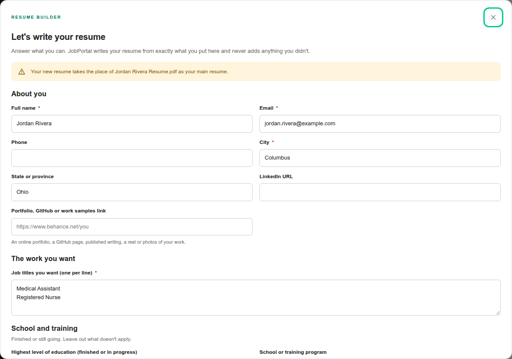
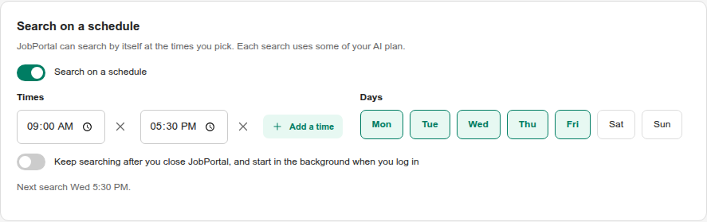
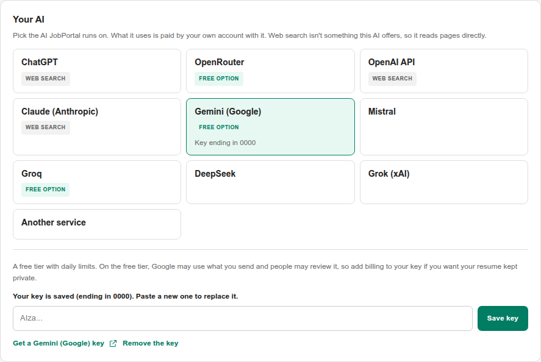

# JobPortal user manual

JobPortal finds jobs that fit you and gets each application ready to send: a tailored resume, a cover letter, outreach
emails with the people to send them to, and interview prep. It works for any field and any level, from high school and the
trades to graduate degrees. Everything stays on your computer, and nothing is ever sent, posted or applied for without you.

To install it, see the [installation guide](INSTALL.md). The pictures here use a fictional person.

## Contents

1. [Getting started](#1-getting-started)
2. [Home](#2-home)
3. [Leads](#3-leads)
4. [A lead's details](#4-a-leads-details)
5. [Tracker](#5-tracker)
6. [Analysis](#6-analysis)
7. [Settings](#7-settings)
8. [Privacy and costs](#8-privacy-and-costs)
9. [Questions](#9-questions)

## 1. Getting started

1. **Connect your AI.** JobPortal's AI runs on your own account. Pick one:
   - **Continue with ChatGPT** if you have a ChatGPT Go, Plus or Pro plan.
   - **Sign in with OpenRouter** under "No ChatGPT plan?". OpenRouter has free models with a daily limit, and paid ones.
   - **Add a key** from Google Gemini (it has a free tier), Claude, OpenAI, Mistral, Groq, DeepSeek, xAI or another service.
2. **Add your resume.** Drop it on Home with anything else that shows what you've done: certificates, licenses, cover
   letters, awards, transcripts. PDF, Word, ODT, RTF, Markdown and plain text all work. JobPortal picks your best resume as
   the main one, and you can pick another.
3. **No resume?** Click "No resume? Answer a few questions and JobPortal writes one." See [the resume builder](#the-resume-builder).
4. **Answer the questions.** Home asks the standard job-application questions one at a time, required ones first. Whatever
   your resume answers is filled in already, so you only check it.
5. **JobPortal builds your profile.** It reads everything you gave it and writes your profile: your experience, skills and
   what to search for. It usually takes one to four minutes.
6. **Run a search.** Click Run search at the top, or let it [search on a schedule](#search).

### The resume builder

The builder asks for your contact details, the jobs you want, your school or training, your work and volunteering (paid or
not), your skills and languages, certifications, and projects, activities and awards. Click Write my resume, and the AI
writes a one-page resume from exactly what you wrote. It never adds anything you didn't write. The new resume becomes your
main resume, and a copy goes to Settings, Resumes, where you can edit it and download it as a PDF or Word file. To change
something, click Change your answers on the main resume and write it again.

## 2. Home

- **The stats** at the top: leads ready, applications sent and interviews. Each opens the page it counts.
- **Questions for you:** one thing at a time. Your resume, what was read from it, the standard questions, the profile build,
  then questions JobPortal asks along the way. Each answer makes every later application better.
- **Next moves:** a few things worth doing soon, when there are any. An application with no reply after three weeks (follow
  up, or move it to Rejected), a new opening at a company that turned you down before, and companies with several openings
  that fit you. Hide one to keep it away for 30 days.
- **Top leads:** your five best matches that are ready to apply.
- **On the right:** your profile and its progress, your documents, and where the search looks.
- The heading says when the next scheduled search starts, when searching on a schedule is on.

## 3. Leads

Every job JobPortal found, ranked by how well it fits you. The tabs split them by stage: Ready (tailored and ready to
apply), In progress, Filtered out, Closed and Deleted. Sort and filter by match, date, industry or kind, or show only your
Dream list. The search box at the top searches your leads from any page.

- **Live search** shows what a search is doing while it runs.
- **Sources** is where you choose where JobPortal looks: LinkedIn, company job boards (Greenhouse, Lever, Ashby, Workday,
  UKG, iCIMS, SmartRecruiters, Recruitee and Personio; paste any company's careers page to add it), remote boards, USAJobs,
  The Muse, Reddit, Mastodon, Bluesky, X (with your own X developer key), Hacker News, RSS feeds, Adzuna and Google Jobs,
  plus the AI hunt missions. Each source can be tested on its own.
- **Add a job** adds one job from a link or its pasted posting, and starts tailoring it.
- **Paste posts** (in Add a job and in Sources) is for communities apps can't read: Discord, Slack, Facebook groups,
  Threads, LinkedIn posts and others. Copy the posts you see there and paste them, with their links. JobPortal finds each
  opening, adds it to your leads, and scores it like any other.

## 4. A lead's details

Click a lead to open everything about it:

- **Why it fits:** the match score, the reasons, and anything to watch for.
- **Resume and cover letter:** tailored to the job, with an editor, a recruiter-style review, Revise with AI, and PDF or
  Word downloads.
- **Emails and contacts:** the people worth writing to, with emails written for them.
- **Interview prep and a company brief.**
- **Apply:** opens the application page. Then move the lead along on the Tracker.

## 5. Tracker

Your applications on a board with five columns: Ready to apply, Application sent, In interview, Accepted and Rejected.
Drag cards between columns, add a job in seconds, delete one (with Undo), and see your contacts. Moving a card to
Application sent records the date and sets a follow-up reminder.

## 6. Analysis

How your fit compares with what the market wants, for the job titles in your own resume, documents and searches. The
chart's roles change as your search does, and you can add or remove roles. Run the analysis for an AI assessment of your
fit and interest.

## 7. Settings

- **Profile:** your standard answers and every part of your profile (facts, skills, experience and projects, stories,
  targeting, writing voice), with its history. Edit anything; your edits stay unless your sources say otherwise.
- **Search:** where to look, your experience levels, the search plan, the Dream list, filters, industries, how much each
  search does, and searching on a schedule.
- **Resumes:** your saved resumes, the recruiter review and the resume playbook.
- **AI:** the AI JobPortal runs on, the model and effort for each kind of task, and the prompts.
- **Appearance:** light or dark, and desktop alerts with a Send a test alert button.
- **History:** every search and its log.
- **Data:** your data folder, putting settings back to their defaults, and Quit.

### Search

Turn on **Search on a schedule**, pick the times and the days, and JobPortal searches by itself. A time missed while your
computer was off or asleep starts its search as soon as JobPortal runs again, once. Turn on **Keep searching after you close
JobPortal** to keep it going in the background and after a restart: JobPortal then starts in the background when you log
in. With desktop alerts on, a scheduled search that finds new jobs tells you so.

### AI

Pick the AI JobPortal runs on. ChatGPT signs in with one click. OpenRouter signs in or takes a key. Every other AI takes a
key, which JobPortal checks before saving it, with a link to where you get one. Keys stay on your computer, and JobPortal
only ever shows their last four characters. Models lists the models your AI offers for each kind of task.

Some AIs can search the web themselves (ChatGPT, the OpenAI API and Claude). The others read pages directly, which works
too, a little less widely.

## 8. Privacy and costs

- Your resume, profile, leads and documents stay in JobPortal's folder on your computer.
- Each AI task sends your AI only what that task needs. Your sign-ins and keys never leave your computer except to talk to
  your AI.
- On Google Gemini's free tier, Google may use what you send to improve its products, and people may review it. Add
  billing to your Gemini key if you want your resume kept private.
- JobPortal itself is free. Your AI account pays for what the AI uses. Each search uses some of it, more with a higher
  effort or more applications tailored per search (Settings, Search).

## 9. Questions

**Does JobPortal apply for me?** No. It finds and prepares. You decide and apply.

**Why are some sites missing from Sources?** Some places don't let apps read them (Discord, Slack, Facebook groups,
Threads, LinkedIn posts). Use Paste posts for those. The AI hunt also checks what search engines show from LinkedIn, X,
Indeed, ZipRecruiter and Handshake.

**Why does a search pause?** Your AI account reached a limit: a usage cap, no credit left, or too many requests at once.
JobPortal waits a few minutes and goes on.

**How do I stop background searching?** Turn off Keep searching after you close JobPortal in Settings, Search, or use Quit
in Settings, Data.

**Where do I report a problem?** Open an issue on the project's GitHub page, with what you did and what happened. Leave out
your resume and personal details.
